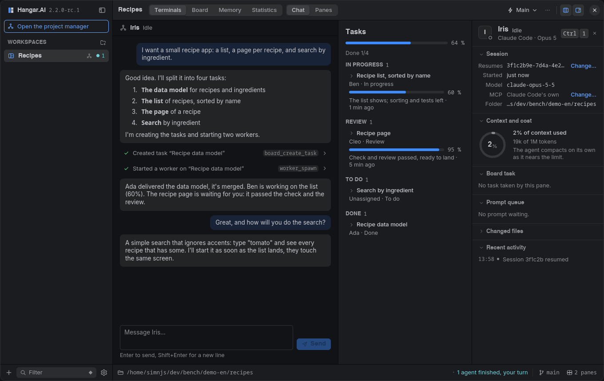

<p align="center">
  
</p>

<h1 align="center">Hangar.AI</h1>

<p align="center">
  <b>Run a team of Claude Code agents in one native window, and steer them from your phone.</b>
</p>

<p align="center">
  <a href="https://github.com/hangar-ai/hangar/releases/latest"></a>
  <a href="https://github.com/hangar-ai/hangar/actions/workflows/ci.yml"></a>
  <a href="LICENSE"></a>
  
</p>

<p align="center">
  <a href="#install">Download</a> ·
  <a href="docs/guide/README.md">Guide</a> ·
  <a href="CHANGELOG.md">Changelog</a> ·
  <a href="https://hangar.simnjs.fr">Website</a> ·
  <a href="https://discord.gg/hangarai">Discord</a>
</p>



Hangar is an open-source desktop app, written in Rust with no web view. It runs the Claude
Code already on your machine, as many sessions as you need, and gives them a shared board,
a shared memory and an orchestrator. No account, no telemetry, no server of ours.

## What it does

- 🖥️ **Many agents, one window.** Up to 16 terminals per workspace, Claude Code or any
  shell, each showing whether its agent is working, waiting for you, or done.
- 📋 **A shared board and memory over MCP.** Agents claim tasks atomically, leave notes,
  and record what the next session should know.
- 🧭 **Orchestrator and workers.** One agent plans; workers each get a git worktree and a
  branch. Every delivery is merged in a scratch worktree, run through your check command,
  read by a reviewer agent, then landed locally. Hangar never pushes.
- 📱 **Hangar Mobile.** See what waits for you, answer Claude's questions with a tap, allow
  or deny permissions — from your phone, over your own Tailscale network.
- 🧩 **Kits and previews.** Kits add a Claude Code plugin and tabs of their own; agents show
  you images, code, Markdown, PDFs, web pages, video and 3D models beside their terminal.
- 🎙️ **Dictation.** Hold a key and speak; whisper.cpp transcribes locally.

More: [features](docs/guide/features.md) · [orchestration](docs/guide/orchestration.md) ·
[MCP tools](docs/guide/mcp.md) · [privacy](docs/guide/privacy.md)

## Install

Grab the file for your system from the
**[latest release](https://github.com/hangar-ai/hangar/releases/latest)** (under
**Assets**). After that, Hangar updates itself in one click.

| System | File |
|---|---|
| Windows (x64) | `Hangar.AI_<version>_x64-setup.exe` — per-user, no admin rights |
| macOS (Apple Silicon + Intel) | `Hangar.AI_<version>_universal.dmg` — macOS 10.15+ |
| Linux (x86_64) | `.AppImage` (glibc 2.35+, `chmod +x` it), `.deb` or `.rpm` |

You also need [Claude Code](https://code.claude.com/docs/en/overview) installed and signed
in. Then create a workspace (`Ctrl`/`Cmd`+`Shift`+`N`), connect it to Hangar from the MCP
panel (`Ctrl`/`Cmd`+`Alt`+`M` → **Configure**), and run **New orchestrator** from the
command palette.

SmartScreen, Gatekeeper, WebKitGTK, upgrading from 1.x, first steps:
[install guide](docs/guide/install.md). Phone setup (about a minute):
[Hangar Mobile](docs/guide/mobile.md).

### Build from source

```bash
git clone https://github.com/hangar-ai/hangar && cd hangar
scripts/native-dev.sh             # builds and runs Hangar on data of its own
cargo test --workspace
```

Requirements (Rust, cmake, clang, per-OS packages) and the repository layout:
[build guide](docs/guide/building.md).

## Experiments

Off by default, under **Settings › Experiments**:
**chat view** (talk to the orchestrator instead of watching panes, shown above) ·
**nodes** (a headless `hangar-node` on a Linux machine over SSH, [design](docs/native/nodes.md)) ·
**pane scopes** (Linux: each pane in its own systemd scope, so a runaway build is stopped, not Hangar).

## Performance

Hangar 2.0 against 1.12.1, the last web-view release, on the same Linux machine: cold start
0.57 s vs 0.96 s; 16 terminals printing non-stop take 249 MiB vs 8.1 GiB.
[Benchmark](docs/native/BENCHMARK.md).

## Contributing

Ideas and questions on [Discord](https://discord.gg/hangarai); bugs and pull requests on
GitHub — start with [CONTRIBUTING.md](CONTRIBUTING.md) and the
[code of conduct](CODE_OF_CONDUCT.md). Security issues: [SECURITY.md](SECURITY.md).

## License

[MIT](LICENSE) © simnJS
