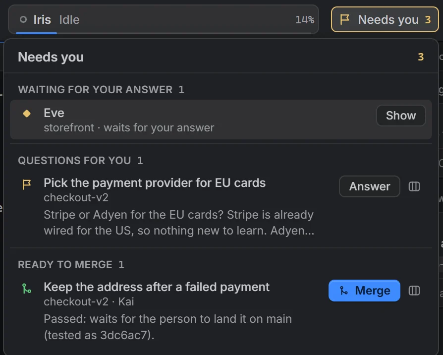
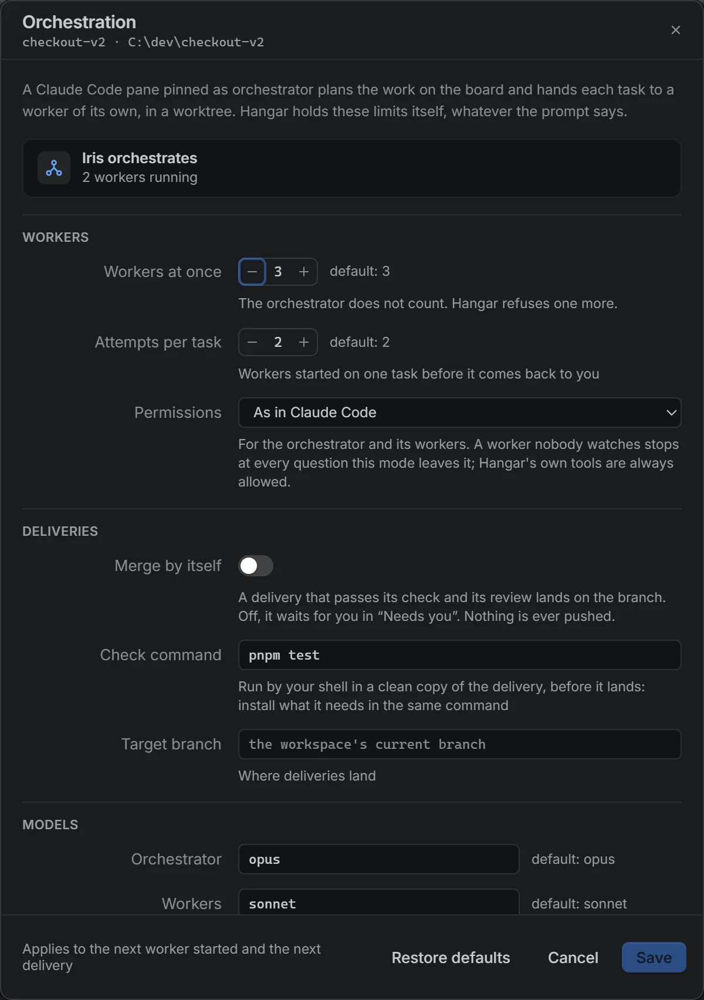
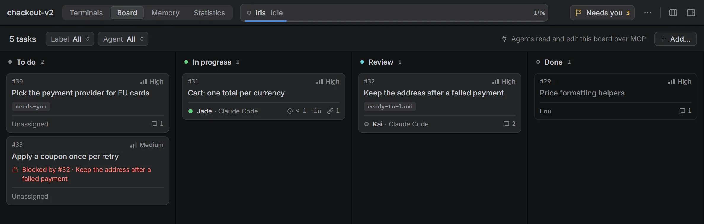
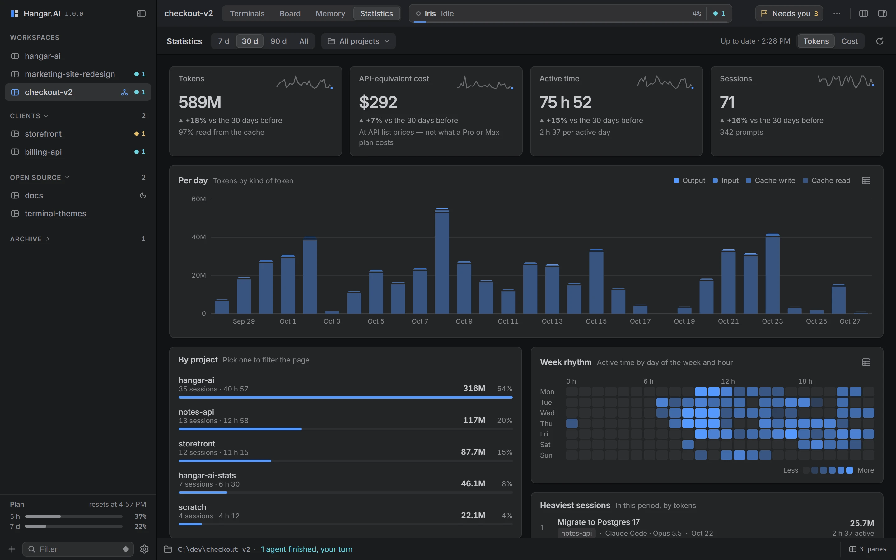

<p align="center">
  
</p>

<h1 align="center">Hangar.AI</h1>

<p align="center">
  Run Claude Code, Codex, Gemini CLI and OpenCode side by side in one window,<br>
  sharing a task board and a memory over MCP.
</p>

<p align="center">
  <a href="https://github.com/simnJS/hangar-ai/releases/latest"></a>
  <a href="LICENSE"></a>
  <a href="https://github.com/simnJS/hangar-ai/actions/workflows/ci.yml"></a>
</p>

<p align="center">
  <a href="https://hangar.simnjs.fr">Website</a> ·
  <a href="https://hangar.simnjs.fr/demo/">Browser demo</a> ·
  <a href="#install">Download</a> ·
  <a href="CHANGELOG.md">Changelog</a>
</p>


<p align="center"><sub>Screenshots are taken from the browser demo, with made-up data.</sub></p>

Hangar.AI is an open-source desktop app for Windows, macOS and Linux, built with Tauri 2
and React. It runs the coding agents you already use, each in a real terminal, and gives
them a shared place to coordinate.

## Why Hangar

Running several coding agents at once usually means a pile of terminal windows. You lose
track of which one is waiting for you, two of them edit the same file, and none of them
knows what the others are doing.

Hangar keeps them in one window:

- **One window, many agents.** Up to 16 terminals per workspace. Each pane shows whether
  its agent is working, waiting for your answer, or done.
- **A shared board.** Agents read and write a kanban board per workspace over MCP. Claims
  are atomic, so two agents cannot take the same task.
- **A shared memory.** Facts one agent records are there for the next session, in any
  project.
- **Orchestration (new in 1.0).** One agent plans. Workers do the work in separate git
  worktrees, and each delivery is checked and reviewed before it is merged locally.

Hangar launches the agent CLIs installed on your machine, with your accounts and your
settings. It is not a model provider, and it has no online service of its own.

## Contents

- [Features](#features)
- [Install](#install)
- [Getting started](#getting-started)
- [How agents use Hangar's MCP server](#how-agents-use-hangars-mcp-server)
- [Privacy](#privacy)
- [Build from source](#build-from-source)
- [Repository layout](#repository-layout)
- [Contributing](#contributing)
- [License](#license)

## Features

### Orchestrator mode

Pin a Claude Code pane as a workspace's orchestrator. It plans the work on the board and
starts workers to carry it out. You follow everything from one window.

**How it works**

1. **Plan.** The orchestrator breaks the goal into board tasks. Each task lists its
   dependencies and the files it owns.
2. **Start workers.** `worker_spawn` gives a task to a new Claude Code pane (Sonnet by
   default). The worker runs in its own git worktree, on a new branch from the target
   branch, with a block of 20 ports for its dev servers and tests.
   Hangar enforces the limits, whatever the prompt says:
   - it refuses a task whose files overlap a task already in progress;
   - it runs 3 workers at once by default;
   - it allows 2 attempts per task by default, then hands the task back to you.
3. **Deliver.** A worker hands in its branch with `delivery_submit`, and the branch joins
   a merge queue. Each delivery goes through four steps:
   - the branch is merged in a temporary worktree;
   - the workspace's check command (`pnpm test`, `cargo test`…) runs there, if you set
     one;
   - a separate reviewer agent reads the change with a fresh context and read-only tools;
   - if all of that passes, the branch lands on the target branch by fast-forward.

   If a step fails, the worker receives what failed and fixes it. Nothing is ever pushed,
   and a landing that would overwrite your uncommitted changes is held back.
4. **Wake on events.** The orchestrator does not poll. When it is between turns, Hangar
   sends it one batched message: a worker commented, is waiting, or exited; a delivery
   landed or failed.
5. **Needs you.** One list, across workspaces, shows what waits for you:
   - agents asking for a permission or an answer;
   - questions the orchestrator handed back to you;
   - deliveries ready to merge, when automatic merging is off.

You set the following per workspace: the models of the orchestrator, workers and reviewer
(Opus, Sonnet and Sonnet by default), the limits, the check command, the target branch,
automatic merging and the permission mode. Orchestration needs a git repository and
Claude Code.

<table>
  <tr>
    <td width="50%"></td>
    <td width="50%"></td>
  </tr>
  <tr>
    <td align="center"><sub>Needs you: what waits for you, across workspaces</sub></td>
    <td align="center"><sub>Orchestration settings of a workspace</sub></td>
  </tr>
</table>

### The Pro interface

- **Navigator** on the left: workspaces and folders, and each workspace's agents and their
  state at a glance.
- **Inspector** on the right: the focused pane's session, context use and cost, its board
  task, its queued prompts and the files it touched.
- **Command palette** (`Ctrl`/`Cmd`+`Shift`+`P`). Every command, pane and workspace is
  behind one search field.
- **33 themes.** Graphite is the default; the others are ported from popular VS Code
  palettes. Each theme restyles the whole window, not only the terminals.
- **Keyboard and language.** Every shortcut can be rebound, and `F6` moves between
  regions. The interface is in English or French.

### Agents and terminals

- **Agents and shells.** Each pane runs Claude Code, Codex, Gemini CLI, OpenCode or a
  plain shell: PowerShell, cmd, Git Bash, WSL, zsh, bash, fish, Nushell…
- **Session resume.** Claude Code and Codex panes reopen on the conversation they were in.
- **Claude Code bridge.** A small mod reports turns, permission prompts, context fill and
  plan usage, so pane states are exact rather than guessed. When an agent edits a file
  another pane just changed, it is told who changed it and asked to re-read it.
- **Broadcast.** Send one instruction to every pane at once. Claude Code panes can also
  hold it until their agent is free.
- **Pane tools.** Zoom a pane to the full grid, search its scrollback, drop a file on it
  to paste its path, or run a saved command in it.

### Workspaces

- **Saved workspaces.** A workspace is a project folder and its layout, and reopening it
  brings every agent back. Workspaces can be grouped in folders, or moved to a window of
  their own.
- **Sleep.** A workspace idle for 10 minutes is put to sleep to free memory. When you open
  it again, its agents resume their sessions. You can change the delay or turn this off.
- **MCP servers per workspace.** Choose which MCP servers a workspace's Claude Code panes
  start, instead of starting every configured server in every pane.
- **Git worktrees and diffs.** Create, lock and remove worktrees, open one in a pane or in
  its own workspace, and see what an agent changed in its folder.

### Board, memory and statistics

- **Task board.** Priorities, dependencies, labels, assignees and comments. It opens as a
  full view or as a panel beside the terminals. Stored in `.hangar/board.json` in the
  project.
- **Global memory.** Agents search, write and update facts across projects. You can browse
  and edit them in the Memory view.
- **Usage statistics.** Tokens, active time and the equivalent cost at API prices, per
  project and per model. They are read from the transcripts Claude Code and Codex keep on
  disk. On a Claude or ChatGPT subscription, the cost figure is an equivalent, not a bill.





### Also

- **3D preview.** Agents show you a model (glTF/GLB, OBJ, STL, PLY, FBX, USDZ) in a panel,
  and render snapshots to check their own work.
- **Dictation.** Hold a key, speak, and the text is typed into the focused pane. It runs
  locally with whisper.cpp, on a model downloaded once. Groq is an optional fallback, with
  its key kept in the system keychain.
- **Discord Rich Presence**, off unless you turn it on.

## Install

Download the file for your system from the
**[latest release](https://github.com/simnJS/hangar-ai/releases/latest)**, under
**Assets**. You only download once: the app updates itself after that.

| System | File | Notes |
|---|---|---|
| Windows (x64) | `Hangar.AI_<version>_x64-setup.exe` | Installs for your user only, without administrator rights. Needs WebView2, which ships with Windows 11. |
| macOS (Apple Silicon and Intel) | `Hangar.AI_<version>_universal.dmg` | One universal build for both. |
| Linux (x86_64) | `.AppImage`, `.deb` or `.rpm` | The AppImage runs without installing (`chmod +x` it first). Needs WebKitGTK 4.1: `libwebkit2gtk-4.1-0` on Debian and Ubuntu, `webkit2gtk4.1` on Fedora. |

> [!NOTE]
> **Windows: SmartScreen.** The installer is not code-signed, so on first run SmartScreen
> shows "Windows protected your PC". Click **More info**, then **Run anyway**.
>
> **macOS: Gatekeeper.** The release workflow signs and notarises the macOS build when
> Apple credentials are configured, and the app then opens normally. If a release's notes
> say the macOS build is unsigned (or you built it yourself), macOS blocks the first
> launch. Right-click the app and choose **Open**. On macOS 15 and later, go to **System
> Settings → Privacy & Security** and click **Open Anyway**.

You also need at least one agent CLI installed and signed in: [Claude Code](https://docs.claude.com/en/docs/claude-code/overview),
[Codex](https://github.com/openai/codex), [Gemini CLI](https://github.com/google-gemini/gemini-cli)
or [OpenCode](https://github.com/sst/opencode). Hangar launches them; it does not install
them.

## Getting started

1. **Create a workspace** with `Ctrl`/`Cmd`+`Shift`+`N`. Pick a project folder and a
   layout, then click a cell to choose its agent. Agents that are not installed are
   marked as such.
2. **Connect the agents to Hangar.** Open the MCP panel (`Ctrl`/`Cmd`+`Alt`+`M`) and click
   **Configure**. The panel can also write a short playbook into the project's `AGENTS.md`
   and `CLAUDE.md`, telling agents to claim tasks before they start. Restart the agents so
   they load the server.
3. **Give them work.** Add tasks on the board (`Ctrl`/`Cmd`+`Alt`+`B`), or ask an agent to
   split a goal into tasks. Other agents pick tasks up with `board_next_task`.
4. **Try orchestration.** In a git repository, run **New orchestrator** from the command
   palette (`Ctrl`/`Cmd`+`Shift`+`P`), or pin an existing Claude Code pane from its **…**
   menu. Then describe the goal to it. **Orchestration…** in the same menu opens the
   workspace's settings: models, limits, check command and automatic merging.

The command palette lists every command. Shortcuts can be changed in
**Settings → Shortcuts**, and the defaults use `Ctrl` on Windows and Linux and `Cmd` on
macOS.

## How agents use Hangar's MCP server

The MCP server is the app's own binary, started as `hangar-ai --mcp` over stdio. Each call
goes to the running app through a local HTTP API on `127.0.0.1`. The port and the token
change at each launch and are never written into agent configs. Every board change goes
through a single lock, so claims stay atomic across panes.

The MCP panel registers the server in each tool's own format:

| Tool | Config file |
|---|---|
| Claude Code | `.mcp.json` (project) |
| Codex | `~/.codex/config.toml` |
| Gemini CLI | `~/.gemini/settings.json` |
| Cursor | `.cursor/mcp.json` (project) |
| VS Code | `.vscode/mcp.json` (project) |

Hangar merges its entry into the existing configuration rather than overwriting it, and
keeps a backup the first time it writes a file.

| Tools | What agents do with them |
|---|---|
| `board_list_tasks`, `board_next_task`, `board_claim_task`, `board_create_task`, `board_update_task`, `board_comment_task`, `board_delete_task` | Read the board, take the highest-priority free task whose dependencies are done, claim it (this fails if another agent holds it), split work into new tasks, move tasks between columns, and leave notes for each other. |
| `memory_search`, `memory_read`, `memory_write`, `memory_update`, `memory_list`, `memory_delete` | Look up what earlier sessions learned before starting, and record decisions, pitfalls and conventions. Writing an existing title replaces that entry. |
| `workspace_list`, `workspace_window`, `pane_list`, `pane_create`, `pane_send`, `pane_read`, `pane_restart`, `pane_close`, `pane_focus` | See the other panes and their state, open a pane with another agent (in a worktree, for instance), type into a pane or queue a prompt until it is idle, read its output, and show a pane to you. |
| `worker_spawn`, `worker_list`, `worker_stop`, `delivery_submit`, `delivery_status` | Orchestration. The orchestrator starts, lists and stops workers. A worker hands in its branch for check, review and merge. |
| `model_show`, `model_snapshot`, `model_close` | Open a 3D model in the preview panel, render it to an image to check it, and close it. |

You can test the server by hand from a build:

```bash
echo '{"jsonrpc":"2.0","id":1,"method":"tools/list"}' | ./src-tauri/target/debug/hangar-ai --mcp
```

## Privacy

Hangar has no account, no telemetry and no backend. Your workspaces, the board, the memory
and the statistics stay on your machine:

- each workspace's board is in `.hangar/board.json` in the project. Hangar keeps it out of
  `git status` through `.git/info/exclude`, unless you commit it yourself;
- the app state and the memory are in the app's data folder;
- the statistics are computed from the transcripts the agents already keep locally, and
  are never sent anywhere;
- the MCP API listens on `127.0.0.1` only, behind a token that changes at each launch.

Hangar itself only goes online in these cases:

- **Updates.** It checks the GitHub release feed for a new version.
- **Dictation.** It downloads the speech model from Hugging Face once, when you choose it.
  It sends audio to Groq only if you choose Groq as the engine, and the transcript only if
  you turn on the optional cleanup pass, which also runs on Groq.
- **Discord.** Rich Presence talks to your local Discord client, and only if you turn it
  on.

The agents you run talk to their own providers under their own settings. Hangar does not
change that.

## Build from source

You need:

- **Node.js** 22, as in CI (Vite 7 needs at least 20.19), and **pnpm** 10;
- **Rust** stable;
- **cmake** and **LLVM/clang**: dictation compiles whisper.cpp from source and generates
  its bindings with libclang;
- the Tauri prerequisites for your system:
  - **Windows:** the MSVC build tools and WebView2. For example,
    `winget install Kitware.CMake LLVM.LLVM`;
  - **macOS:** the Xcode command line tools (`xcode-select --install`, which includes
    clang) and `brew install cmake`;
  - **Linux:** the WebKitGTK, ALSA and libclang headers, as installed by CI on Ubuntu
    22.04:

    ```bash
    sudo apt install build-essential cmake libwebkit2gtk-4.1-dev libayatana-appindicator3-dev \
      librsvg2-dev libxdo-dev libssl-dev libasound2-dev libclang-dev patchelf
    ```

Then:

```bash
pnpm install
pnpm tauri dev      # run the app with hot reload
pnpm tauri build    # build the installers for this platform
pnpm demo:dev       # the browser demo, with canned agents, on http://localhost:4300
```

> [!WARNING]
> If Hangar is already installed on your machine, a plain `pnpm tauri dev` shares its data
> and its MCP endpoint. Your installed agents would then talk to the dev build. See
> [CONTRIBUTING.md](CONTRIBUTING.md#running-a-dev-build-next-to-an-installed-hangar) to run
> the two side by side.

## Repository layout

```
src/                 React frontend (components, lib, styles, i18n)
src-tauri/src/       Rust backend: PTYs, board, memory, MCP server, git, deliveries, stats, dictation
src-tauri/claude-mod/hangar-bridge/
                     the Claude Code mod that reports session state to Hangar
src-tauri/installer/ NSIS installer script and artwork
demo/                the browser demo: src/ compiled unchanged against a fake backend
site/                the website at hangar.simnjs.fr
scripts/             logo, installer art, demo model and demo bundling scripts
.github/workflows/   CI (checks on every push and PR) and Release (builds and publishes on a tag)
```

## Contributing

Bug reports, ideas and pull requests are welcome. Start with
[CONTRIBUTING.md](CONTRIBUTING.md). It covers the setup, the checks CI runs and the commit
style. Please follow the [code of conduct](CODE_OF_CONDUCT.md). To report a security
issue, see [SECURITY.md](SECURITY.md) and do not open a public issue.

## License

[MIT](LICENSE) © simnJS
