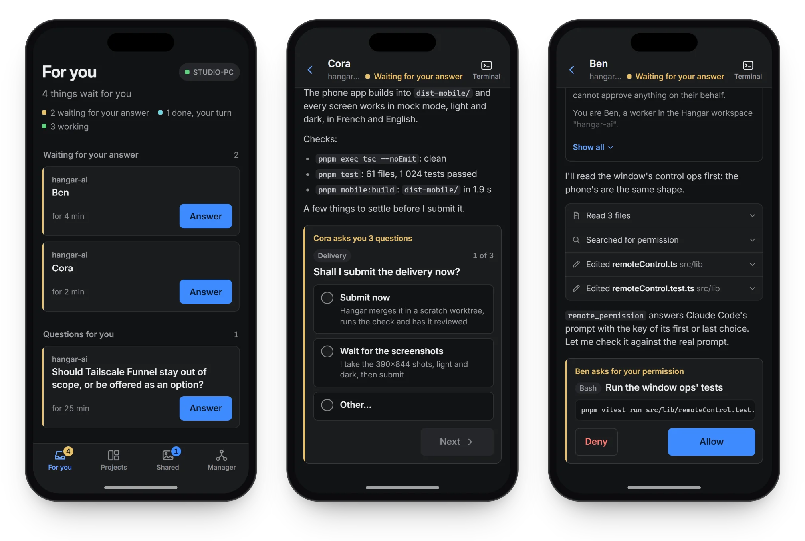
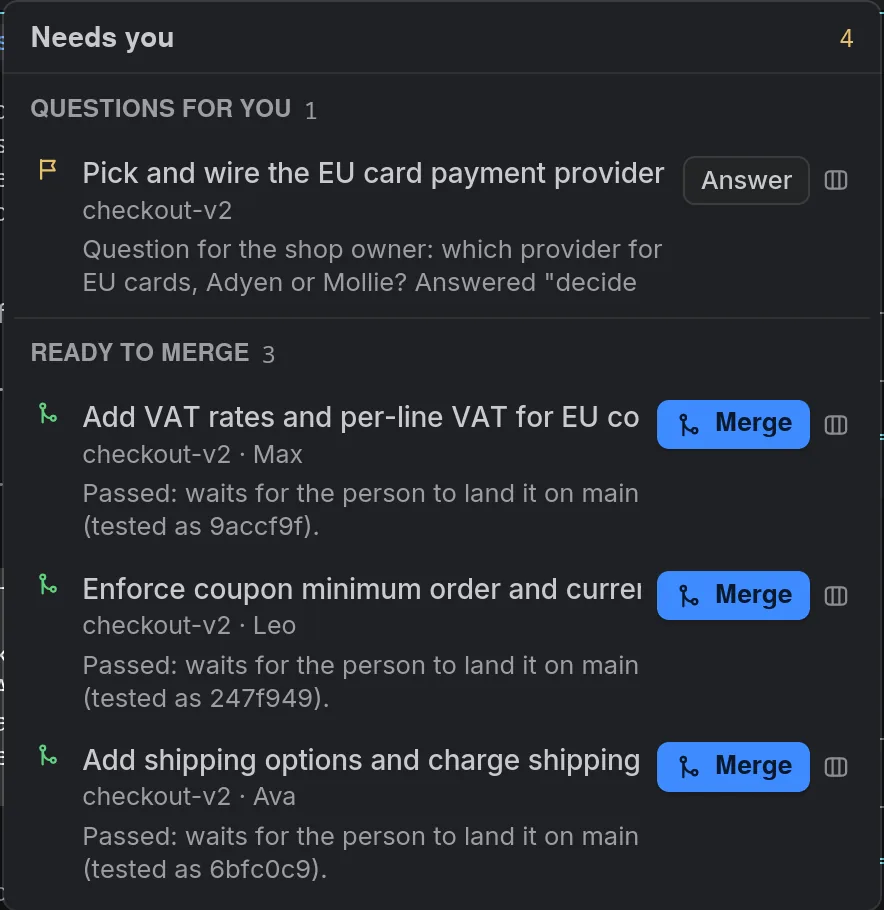
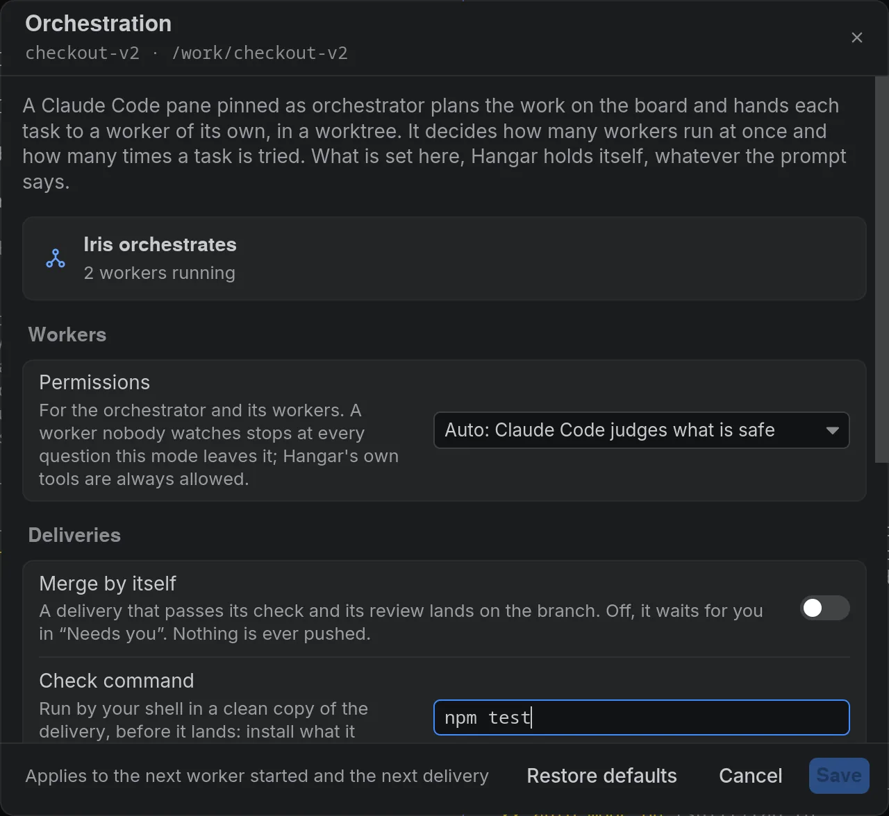
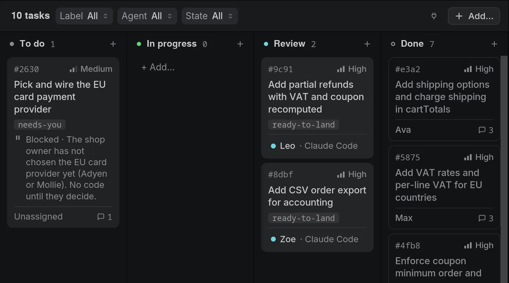
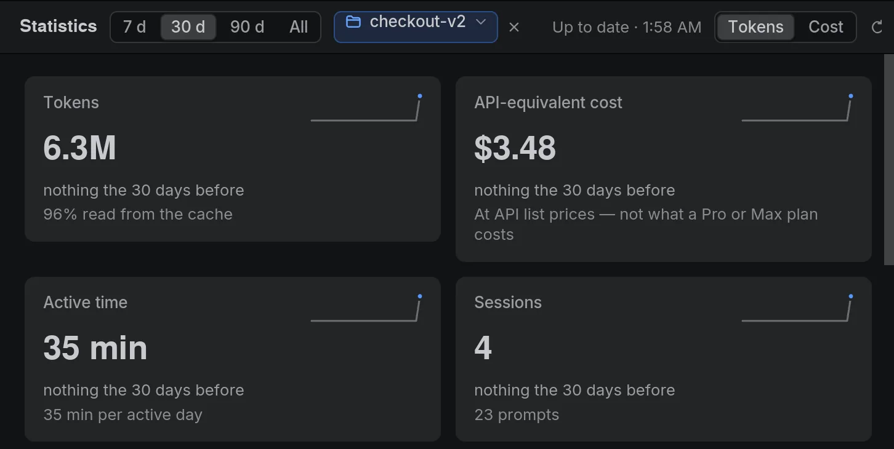

<p align="center">
  
</p>

<h1 align="center">Hangar.AI</h1>

<p align="center">
  Run many Claude Code sessions side by side in one native window,<br>
  sharing a task board and a memory over MCP, and follow and steer them from your phone.
</p>

<p align="center">
  <a href="https://github.com/hangar-ai/hangar/releases/latest"></a>
  <a href="LICENSE"></a>
  <a href="https://github.com/hangar-ai/hangar/actions/workflows/ci.yml"></a>
</p>

<p align="center">
  <a href="https://hangar.simnjs.fr">Website</a> ·
  <a href="#hangar-mobile">Hangar Mobile</a> ·
  <a href="#performance">Performance</a> ·
  <a href="#install">Download</a> ·
  <a href="CHANGELOG.md">Changelog</a> ·
  <a href="https://discord.gg/hangarai">Discord</a>
</p>


<p align="center"><sub>Screenshots of a real session in Hangar 1.0: Claude Code agents at work on checkout-v2, a sample repository. Hangar 2.0 draws the same interface natively.</sub></p>

Hangar.AI is an open-source desktop app for Windows, macOS and Linux. It runs Claude Code,
as many sessions as you need, each in a real terminal next to plain shells, and gives them
a shared place to coordinate.

**Hangar 2.0 is native.** The whole app is written in Rust and drawn with
[iced](https://iced.rs), with no web view in it: it starts faster, and sixteen busy
terminals take a few hundred megabytes instead of several gigabytes
([Performance](#performance)). It reads the data of Hangar 1.x as it is, and a 1.x install
updates to it by itself.

With **Hangar Mobile**, you follow and steer them from your phone while Hangar keeps running
on your PC: see what waits for you in every project, answer an agent, allow or deny a
permission, and reply to Claude's questions with a tap in a real chat. Hangar serves it
itself, through your own Tailscale network: no app store, no account and no server of ours.
[Set it up](#hangar-mobile) in about a minute.

<p align="center">
  
</p>

<p align="center"><sub>Hangar Mobile on its sample projects.</sub></p>

## Why Hangar

Running several coding agents at once usually means a pile of terminal windows. You lose
track of which one is waiting for you, two of them edit the same file, and none of them
knows what the others are doing.

Hangar keeps them in one window, and on your phone:

- **One window, many agents.** Up to 16 terminals per workspace. Each pane shows whether
  its agent is working, waiting for your answer, or done.
- **On your phone (new in 1.1).** Hangar Mobile lists what waits for you in every project.
  Answer an agent, allow a permission or reply to Claude's questions from the phone, while
  the agents keep working on your PC.
- **A shared board.** Agents read and write a kanban board per workspace over MCP. Claims
  are atomic, so two agents cannot take the same task.
- **A shared memory.** Facts one agent records are there for the next session, in any
  project.
- **Orchestration (new in 1.0).** One agent plans. Workers do the work in separate git
  worktrees, and each delivery is reviewed, and run through your check command if you set
  one, before it is merged locally.
- **Native (new in 2.0).** No web view and no browser engine in the app, so typing stays
  instant even while every terminal prints.

Hangar launches the Claude Code installed on your machine, with your accounts and your
settings. It is not a model provider, and it has no online service of its own.

## Contents

- [Features](#features)
- [Performance](#performance)
- [Install](#install)
- [Getting started](#getting-started)
- [Hangar Mobile](#hangar-mobile)
- [How agents use Hangar's MCP server](#how-agents-use-hangars-mcp-server)
- [Kits](#kits)
- [Privacy](#privacy)
- [Build from source](#build-from-source)
- [Repository layout](#repository-layout)
- [Contributing](#contributing)
- [License](#license)

## Features

### On your phone: Hangar Mobile

Follow and steer your projects from your phone while Hangar keeps running on your PC (new
in 1.1, with a real chat since 1.2):

- **For you** lists what waits for you in every project: an agent asking for a permission,
  a question from an orchestrator, a delivery ready to land.
- **A real chat.** A Claude Code pane, and the project manager, open as a conversation:
  your messages, Claude's answers with their formatting, and one line per action that opens
  its detail. Shells keep the terminal view.
- **Claude's questions as buttons**, several choices when it allows them, and "Other" with a
  text field. Your answer reaches the session on the PC as if you had typed it there.
- **Permissions** show the tool and what it will do (the command, the file), with Allow and
  Deny.
- **Files and notifications.** Agents share images and files with you through
  `phone_share`, and notifications reach the phone even with the app closed.
- **Since your last visit** shows what happened while you were away.

It reaches your PC through Tailscale, from your own devices only. See
[Hangar Mobile](#hangar-mobile) to set it up.

### Orchestrator mode

Pin a Claude Code pane as a workspace's orchestrator. It plans the work on the board and
starts workers to carry it out. You follow everything from one window.

**How it works**

1. **Plan.** The orchestrator breaks the goal into board tasks. Each task lists its
   dependencies and the files it owns.
2. **Start workers.** `worker_spawn` gives a task to a new Claude Code pane (Sonnet by
   default). The worker runs in its own git worktree, on a new branch from the target
   branch, with a block of 20 ports for its dev servers and tests.
   Hangar enforces the limits, whatever the prompt says:
   - it refuses a task whose files overlap a task already in progress;
   - it runs 3 workers at once by default;
   - it allows 2 attempts per task by default, then hands the task back to you.
3. **Deliver.** A worker hands in its branch with `delivery_submit`, and the branch joins
   a merge queue. Each delivery goes through four steps:
   - the branch is merged in a temporary worktree;
   - the workspace's check command (`pnpm test`, `cargo test`…) runs there, if you set
     one;
   - a separate reviewer agent reads the change with a fresh context and read-only tools;
   - if all of that passes, the branch lands on the target branch by fast-forward.

   If a step fails, the worker receives what failed and fixes it. Hangar never pushes, and
   a landing that would overwrite your uncommitted changes is held back.
4. **Wake on events.** The orchestrator does not poll. When it is between turns, Hangar
   sends it one batched message: a worker commented, is waiting, or exited; a delivery
   landed or failed.
5. **Needs you.** One list, across workspaces, shows what waits for you:
   - agents asking for a permission or an answer;
   - questions the orchestrator handed back to you;
   - deliveries ready to merge, when automatic merging is off.

You set the following per workspace: the models of the orchestrator, workers and reviewer
(Opus, Sonnet and Sonnet by default), the limits, the check command, the target branch,
automatic merging (on by default) and the permission mode. Orchestration needs a git repository and
Claude Code.

<table>
  <tr>
    <td width="50%"></td>
    <td width="50%"></td>
  </tr>
  <tr>
    <td align="center"><sub>Needs you: what waits for you, across workspaces</sub></td>
    <td align="center"><sub>Orchestration settings of a workspace</sub></td>
  </tr>
</table>

### Project manager

One agent to talk to instead of every project's agents (new in 1.0.3). Open it from the top
of the sidebar or the command palette: Hangar creates an HQ workspace with its own folder and
one Claude Code agent (Opus by default) that follows every workspace, with or without an
orchestrator.

- **Ask it where your projects stand:** agents, boards, what waits for you, deliveries ready
  to land, each plan's status.
- **Ask it to pass an instruction on.** It is queued for that project's orchestrator, and a
  sleeping workspace wakes up.
- **It speaks up only for what waits for you:** an agent waiting for an answer or a
  permission, a task marked needs-you, a delivery ready to land, a board whose tasks are all
  done.

It keeps a tracker of what you want from each project, handed back after every compaction.
It never writes code and never acts on its own. On your phone, Hangar Mobile opens it as a
chat.

### An interface built like an IDE

- **Navigator** on the left: workspaces and folders, and each workspace's agents and their
  state at a glance.
- **Inspector** on the right: the focused pane's session, context use and cost, its board
  task, its queued prompts and the files it touched.
- **Command palette** (`Ctrl`/`Cmd`+`Shift`+`P`). Every command, pane and workspace is
  behind one search field.
- **33 themes.** Graphite is the default; the others are ported from popular VS Code
  palettes. Each theme restyles the whole window, not only the terminals.
- **Keyboard and language.** Every shortcut can be rebound, and `F6` moves between
  regions. The interface is in English or French.

### Agents and terminals

- **Claude Code and shells.** Each pane runs Claude Code or a plain shell: PowerShell,
  cmd, Git Bash, WSL, zsh, bash, fish, Nushell… Since 2.0, Claude Code is the only agent;
  a pane saved with Codex, Gemini CLI or OpenCode opens as a shell in the same folder.
- **Terminals of its own.** Hangar draws its terminals itself, on alacritty_terminal: true
  colour, mouse modes, links, search, bracketed paste, and dead keys that compose.
- **Session resume.** Claude Code panes reopen on the conversation they were in.
- **Claude Code bridge.** A small mod reports turns, permission prompts, context fill and
  plan usage, so pane states are exact rather than guessed. When an agent edits a file
  another pane just changed, it is told who changed it and asked to re-read it.
- **Broadcast.** Send one instruction to every pane at once. Claude Code panes can also
  hold it until their agent is free.
- **Pane tools.** Zoom a pane to the full grid, search its scrollback, drop a file on it
  to paste its path, or run a saved command in it.

### Workspaces

- **Saved workspaces.** A workspace is a project folder and its layout, and reopening it
  brings every agent back. Workspaces can be grouped in folders, or moved to a window of
  their own.
- **From a Git repository.** In the new-workspace dialog, choose *From a Git repository*,
  paste `owner/repo` or an https or ssh address, and see the folder it will be cloned into
  before anything runs. Hangar clones it (with progress, and a Cancel), opens a workspace
  and starts an orchestrator that reads the repository and gets it ready. A folder that
  already holds the repository is reused. Set the folder repositories go in under *Projects
  folder* in the settings; left empty, it is next to the current workspace's folder.
- **Sleep.** A workspace idle for 10 minutes is put to sleep to free memory. When you open
  it again, its agents resume their sessions. You can change the delay or turn this off.
- **MCP servers per workspace.** Choose which MCP servers a workspace's Claude Code panes
  start, instead of starting every configured server in every pane.
- **Git worktrees and diffs.** Create, lock and remove worktrees, open one in a pane or in
  its own workspace, and see what an agent changed in its folder.

### Board, memory and statistics

- **Task board.** Priorities, dependencies, labels, assignees and comments. It opens as a
  full view or as a panel beside the terminals. Stored in `.hangar/board.json` in the
  project.
- **Global memory.** Agents search, write and update facts across projects. You can browse
  and edit them in the Memory view.
- **Usage statistics.** Tokens, active time and the equivalent cost at API prices, per
  project and model. They are read from the transcripts Claude Code keeps on disk. On a
  Claude subscription, the cost figure is an equivalent, not a bill.





### Kits and previews

- **Kits** bring a domain into Hangar: a Claude Code plugin, setup commands, and tabs of
  their own. A tab is either an HTML page or, new in 2.0, a native tab written in Rust and
  compiled to WebAssembly, which Hangar draws in your theme. The **Library** in
  **Settings → Kits** lists the public kits of the [hangar-ai](https://github.com/hangar-ai)
  organization. See [Kits](#kits).
- **Previews.** Agents show you files beside their terminal: images (animated GIF and WebP
  too), code and text with highlighting, Markdown, PDFs, web pages, video and audio.
- **3D preview.** Agents show you a model (glTF/GLB, OBJ, STL, PLY, FBX) in a panel, with
  its glTF animations, and render snapshots to check their own work.

What needs a browser engine, a PDF, a web page, a video or an HTML kit tab, opens in
`hangar-webview`, a small helper program beside Hangar, in a window of its own.

### Also

- **Dictation.** Hold a key, speak, and the text is typed into the focused pane. It runs
  locally with whisper.cpp, on a model downloaded once. Groq is an optional alternative, with
  its key kept in the system keychain.
- **Discord Rich Presence**, off unless you turn it on.

## Performance

Hangar 1.12.1, the last release built on a web view, against Hangar 2.0, on the same Linux
machine:

| | 1.12.1 | 2.0 |
|---|---|---|
| Start, cold | 0.96 s | 0.57 s |
| Memory at rest | 238 MiB | 166 MiB |
| 16 terminals printing non-stop for 30 s: memory | 8.1 GiB | 249 MiB |
| 16 terminals printing non-stop for 30 s: processor | 4.4 cores | 2.4 cores |
| Echo of text sent to a pane while 15 others print | no echo within a minute | 2.5 ms |

Each terminal parses its output on a thread of its own, and the window draws at most once
per frame whatever they print, so a busy pane never holds up the one you type in. The method
and the raw figures are in [docs/native/BENCHMARK.md](docs/native/BENCHMARK.md).

## Install

Download the file for your system from the
**[latest release](https://github.com/hangar-ai/hangar/releases/latest)**, under
**Assets**. You only download once: after that, the app offers each new version and
installs it in one click. A Hangar 1.x install offers 2.0 the same way.

| System | File | Notes |
|---|---|---|
| Windows (x64) | `Hangar.AI_<version>_x64-setup.exe` | Installs for your user only, without administrator rights. HTML kit tabs and PDFs use WebView2, which ships with Windows 11; on Windows 10 the installer adds it if it is missing. |
| macOS (Apple Silicon and Intel) | `Hangar.AI_<version>_universal.dmg` | One universal build for both, macOS 10.15 or later. |
| Linux (x86_64) | `.AppImage`, `.deb` or `.rpm` | The AppImage runs without installing (`chmod +x` it first) on distributions with glibc 2.35 or later (2022 on). HTML kit tabs and PDFs need WebKitGTK 4.1: apt and dnf install it with the `.deb` and `.rpm`; with the AppImage, install `libwebkit2gtk-4.1-0` (Debian, Ubuntu) or `webkit2gtk4.1` (Fedora) if your system lacks it. |

> [!NOTE]
> **Windows: SmartScreen.** The installer is not code-signed, so on first run SmartScreen
> shows "Windows protected your PC". Click **More info**, then **Run anyway**.
>
> **macOS: Gatekeeper.** The macOS build is signed and notarised, so it opens after
> macOS's usual first-launch confirmation. If a release's notes ever say the macOS build is
> unsigned (or you built it yourself), macOS blocks the first launch: right-click the app
> and choose **Open**. On macOS 15 and later, go to **System Settings → Privacy &
> Security** and click **Open Anyway**.

You also need [Claude Code](https://code.claude.com/docs/en/overview) installed and
signed in. Hangar launches it; it does not install it.

**Coming from 1.x.** Accept the update, or install 2.0 over 1.x: it uses the same folders
and the same `state.json`, so your workspaces, boards, memory, settings, shortcuts, kits and
Claude accounts are there. The kit tabs you had left open and each account's cached usage
lived in the old web view, and are not carried over. The [changelog](CHANGELOG.md) lists
what 2.0 does not do yet: mainly, there is no screen reader support, and Windows and macOS
have been tested by CI but not yet used by a person.

## Getting started

1. **Create a workspace** with `Ctrl`/`Cmd`+`Shift`+`N`. Pick a project folder and a
   layout, then click a cell to choose Claude Code or a shell. If Claude Code is not
   installed, the dialog says so.
2. **Connect Claude Code to Hangar.** Open the MCP panel (`Ctrl`/`Cmd`+`Alt`+`M`; `Alt` is
   `Option` on a Mac) and click
   **Configure**. The panel can also write a short playbook into the project's `CLAUDE.md`,
   telling agents to claim tasks before they start. Restart the agents so they load the
   server.
3. **Give them work.** Add tasks on the board (`Ctrl`/`Cmd`+`Alt`+`B`), or ask an agent to
   split a goal into tasks. Other agents pick tasks up with `board_next_task`.
4. **Try orchestration.** In a git repository, run **New orchestrator** from the command
   palette (`Ctrl`/`Cmd`+`Shift`+`P`), or pin an existing Claude Code pane from its **…**
   menu. Then describe the goal to it. **Orchestration…** in the same menu opens the
   workspace's settings: models, limits, check command and automatic merging.

The command palette lists every command. Shortcuts can be changed in
**Settings → Shortcuts**, and the defaults use `Ctrl` on Windows and Linux and `Cmd` on
macOS.

## Hangar Mobile

Hangar Mobile follows and steers your projects from your phone, while Hangar keeps running
on your PC. **For you** lists what waits for you in every project: an agent asking for a
permission, a question from an orchestrator, a delivery ready to land. You can read any
pane's screen as it updates, answer an agent, allow or deny a permission, press `Esc` or
`Enter`, and attach a photo or a file. You can also talk to the project manager, open the
images and files agents share with you, and see what happened since your last visit.
Notifications reach the phone even with the app closed. Merging a delivery is still done
on the PC.

A Claude Code pane, and the project manager, open as a conversation rather than a copy of
the terminal: your messages, Claude's answers, one line per action. When Claude asks you
something, each question shows with its options as large buttons, and a **Terminal** button
still shows any pane's raw screen. Shells keep the terminal view.

It is a web app that Hangar itself serves, and that you add to the phone's Home Screen.
There is no app store, no account and no server of ours in between.

**Set it up** (once, about a minute):

1. **Install [Tailscale](https://tailscale.com/download)** on the PC and on the phone, and
   sign in to the same account on both. It is a free app that links your own devices
   through a private network, wherever they are.
2. **Turn Hangar Mobile on** in Hangar, under **Settings → Mobile**.
3. **Click "Turn on HTTPS access"** in the same section. Tailscale then gives Hangar
   Mobile an address like `https://your-pc.your-tailnet.ts.net`. The first time, Tailscale
   may ask you to allow HTTPS on your network: open the page Hangar shows, then click
   again.
4. **Click "Show the code" and scan the QR code** with the phone's camera. It opens Hangar
   Mobile and pairs the phone. You can also type the 6-digit code, which works once and
   for five minutes.
5. **Add it to the Home Screen.** On an iPhone, in Safari, tap **Share**, then **Add to
   Home Screen**. On Android, in Chrome, open the menu and choose **Add to Home screen**
   (or **Install app**). Open Hangar from there and tap **Turn on notifications**.

> [!NOTE]
> On an iPhone, notifications need **iOS 16.4 or later**, and they only reach the app
> opened from the Home Screen, not a Safari tab.

**Security:**

- Hangar Mobile listens on `127.0.0.1` only, on a port of its own, apart from the agents'
  API: nothing is opened on your local network or on the Internet.
- Tailscale Serve is the only way in, over HTTPS, and only from devices on your own
  Tailscale network.
- Each phone pairs with a one-time code. **Settings → Mobile** lists the paired phones, and
  revoking one cuts it off and stops its notifications.

Your PC has to stay on, with Hangar open, for the phone to reach it. For a few days away,
**Settings → Mobile** has two options: keep the PC from going to sleep while Hangar Mobile
is on, and start Hangar when you log in, with your workspaces and Hangar Mobile.

## How agents use Hangar's MCP server

The MCP server is the app's own binary, started as `hangar-ai --mcp` over stdio. Each call
goes to the running app through a local HTTP API on `127.0.0.1`. The port and the token
change at each launch and are never written into agent configs. Every board change goes
through a single lock, so claims stay atomic across panes.

The MCP panel registers the server in the project's `.mcp.json`, which Claude Code reads,
and approves it once in `~/.claude/settings.json` so it is not asked for again in every
session. Hangar merges its entry into the existing configuration rather than overwriting
it, and keeps a backup the first time it writes a file. To do it by hand instead, run
`claude mcp add hangar --scope project -- "<path to hangar-ai>" --mcp` in the project.

| Tools | What agents do with them |
|---|---|
| `board_list_tasks`, `board_next_task`, `board_claim_task`, `board_create_task`, `board_update_task`, `board_comment_task`, `board_delete_task` | Read the board, take the highest-priority free task whose dependencies are done, claim it (this fails if another agent holds it), split work into new tasks, move tasks between columns, and leave notes for each other. |
| `board_block_task`, `board_unblock_task` | Put a task on hold for something outside the board (a release, a decision, a date) with a reason and an optional `recheck` day, instead of a comment: it returns to todo with nobody on it, `board_next_task` and `worker_spawn` skip it, and its dependents keep waiting. The recheck day passed, it unblocks itself; `human_only` blocks are lifted by a person from the board, never by an agent. |
| `memory_search`, `memory_read`, `memory_write`, `memory_update`, `memory_list`, `memory_delete` | Look up what earlier sessions learned before starting, and record decisions, pitfalls and conventions. Writing an existing title replaces that entry. |
| `workspace_list`, `workspace_window`, `pane_list`, `pane_create`, `pane_send`, `pane_read`, `pane_restart`, `pane_close`, `pane_focus` | See the other panes and their state, open another Claude Code or shell pane (in a worktree, for instance), type into a pane or queue a prompt until it is idle, read its output, and show a pane to you. |
| `workspace_create`, `workspace_set_check` | Any agent can ask for a workspace for a repository the person named (`workspace_create {repo, name?, parent?}`): Hangar clones it, into `parent` when you say where (any absolute folder, on any drive: « put it on my second SSD » gives `E:/AnyPS5`; missing folders are created, and an existing empty folder is used; your Projects folder setting is not changed), creates the workspace and starts an orchestrator that reads the repository, installs its dependencies, sets the check command, runs the tests once and reports. A repository that is not yours is cloned only after you click Clone in Hangar, on a card that shows the destination; for your own, the agent just tells you the folder. The orchestrator sets its own workspace's check command with `workspace_set_check {command}`, and you see it in the orchestration panel. |
| `worker_spawn`, `worker_list`, `worker_stop`, `delivery_submit`, `delivery_status` | Orchestration. The orchestrator starts, lists and stops workers. A worker hands in its branch for check, review and merge. |
| `model_show`, `model_snapshot`, `model_close` | Open a 3D model in the preview panel, render it to an image to check it, and close it. |
| `phone_share` | Send you a file on your phone through [Hangar Mobile](#hangar-mobile): a screenshot, a render, a report you asked to see. |
| `project_list`, `project_status`, `project_send` | The [project manager](#project-manager) only: list every project, read where one stands, and queue an instruction for its orchestrator. |

You can test the server by hand from a dev build, with a dev Hangar running on the same
data (see [Build from source](#build-from-source)):

```bash
echo '{"jsonrpc":"2.0","id":1,"method":"tools/list"}' | scripts/native-dev.sh -- --mcp
```

## Kits

A kit links a domain, a game engine, a studio's tools, a service, to a workspace, without
Hangar knowing anything about it. It can bring a Claude Code plugin (skills, commands,
agents, MCP servers), setup commands that you see verbatim and run once, and tabs: pages of
its own that talk to Hangar through a small, declared API, each permission accepted by you.

- **HTML tabs** are the tabs of 1.x, with the same `window.hangar` API, the same
  permissions, and [Hangar UI](docs/kit-ui.md), the stylesheet that makes them look like
  Hangar. In 2.0 they open in the `hangar-webview` helper, in a window of their own.
- **Native tabs** (new in 2.0) are Rust compiled to WebAssembly with the kit SDK,
  `hangar-kit-sdk`. A tab describes its page as widgets, and Hangar draws them with its own,
  in your theme and language. The module runs in a sandbox with time and memory limits, and
  Hangar answers only the calls its manifest declares. A kit can carry both kinds, so that it
  still opens on 1.x.

Add a kit from a folder, a GitHub link or the Library. To write one, read
[docs/kits.md](docs/kits.md) (the contract) and
[docs/native/kits-native.md](docs/native/kits-native.md) (native tabs and the SDK), look at
[`examples/kits/hello-native`](examples/kits/hello-native), and start from
[`kit-template`](https://github.com/hangar-ai/kit-template).

## Privacy

Hangar has no account, no telemetry and no backend. Your workspaces, the board, the memory
and the statistics stay on your machine:

- each workspace's board is in `.hangar/board.json` in the project. Hangar keeps it out of
  `git status` through `.git/info/exclude`, unless you commit it yourself;
- the app state and the memory are in the app's data folder;
- the statistics are computed from the transcripts the agents already keep locally, and
  are never sent anywhere;
- the MCP API listens on `127.0.0.1` only, behind a token that changes at each launch;
- [Hangar Mobile](#hangar-mobile), off until you turn it on, listens on `127.0.0.1` too, and
  only your own devices reach it, through Tailscale.

Hangar itself only goes online in these cases:

- **Updates.** It checks the GitHub release feed for a new version.
- **Dictation.** It downloads the speech model from Hugging Face once, when you choose it.
  It sends audio to Groq only if you choose Groq as the engine, and the transcript only if
  you turn on the optional cleanup pass, which also runs on Groq.
- **Discord.** Rich Presence talks to your local Discord client, and only if you turn it
  on.
- **Hangar Mobile notifications.** Once you turn them on on a phone, the PC sends them
  through that phone's push service (Apple's, Google's or Mozilla's), encrypted for that
  phone alone, so the push service cannot read them.

The agents you run talk to their own providers under their own settings. Hangar does not
change that.

## Build from source

You need:

- **Rust** stable, and `rustup target add wasm32-unknown-unknown` for native kit tabs;
- **cmake** and **LLVM/clang**: dictation compiles whisper.cpp from source and generates
  its bindings with libclang;
- for your system:
  - **Windows:** the MSVC build tools, plus cmake and LLVM
    (`winget install Kitware.CMake LLVM.LLVM`), and WebView2 for the pages the webview
    helper shows (HTML kit tabs, PDFs);
  - **macOS:** the Xcode command line tools (`xcode-select --install`, which includes
    clang) and `brew install cmake`;
  - **Linux:** the ALSA, libclang and OpenSSL headers, and WebKitGTK for the webview
    helper, as installed by CI on Ubuntu 22.04:

    ```bash
    sudo apt install build-essential cmake libwebkit2gtk-4.1-dev libssl-dev libasound2-dev libclang-dev
    ```
- **Node.js** 22 and **pnpm** 10, only for Hangar Mobile, the phone app: a build without it
  serves the phone a page saying the app is missing.

Then:

```bash
scripts/native-dev.sh             # build and run Hangar, on data of its own under target/dev-home/
scripts/native-dev.sh --release   # the same, optimised
cargo build -p hangar-webview --features engine   # the helper, for HTML kit tabs and PDFs
cargo test --workspace            # the tests
pnpm install
pnpm mobile:build                 # Hangar Mobile into dist-mobile/, which the next build embeds
pnpm mobile:dev                   # Hangar Mobile against a fake PC, on http://localhost:4310
pnpm test                         # Hangar Mobile's tests
```

The installers are built by the scripts under `crates/hangar-app/packaging/`, as the
release workflow runs them: see [docs/native/PACKAGING.md](docs/native/PACKAGING.md).

> [!WARNING]
> If Hangar is already installed on your machine, a plain `cargo run -p hangar-app` shares
> its data and its MCP endpoint, and your installed agents would then talk to the dev
> build. `scripts/native-dev.sh` keeps them apart; see
> [CONTRIBUTING.md](CONTRIBUTING.md#running-a-dev-build-next-to-an-installed-hangar).

## Repository layout

```
crates/hangar-app/       the app, `hangar-ai`: windows, views and state; packaging/ holds the installers
crates/hangar-core/      everything that is not drawing: PTYs, board, memory, MCP server, git, deliveries,
                         stats, dictation, Hangar Mobile's server, the kits and their HTML SDK
crates/hangar-core/claude-mod/hangar-bridge/
                         the Claude Code mod that reports session state to Hangar
crates/hangar-term/      the terminal widget, on alacritty_terminal
crates/hangar-theme/     the 33 themes and the design tokens
crates/hangar-ui/        the widgets every view is built from: buttons, menus, dialogs, the palette…
crates/hangar-i18n/      the interface strings, English and French (dict/en.json, dict/fr.json)
crates/hangar-kit-ui/    the widgets and events of native kit tabs, as data: the public contract
crates/hangar-kit-sdk/   what a kit links to write a native tab
crates/hangar-kit-host/  runs native kit tabs in wasmtime and draws them
crates/hangar-webview/   the helper for HTML kit tabs, PDFs and web pages, and the app's client for it
crates/hangar-model3d/   the 3D preview
crates/hangar-update/    the updater
mobile/                  Hangar Mobile, the phone app, built into dist-mobile/ and embedded in the binary
examples/kits/           example kits, among them hello-native, a native tab
assets/                  the logo, the README's images and the sample 3D models
site/                    the website at hangar.simnjs.fr
scripts/                 the dev launcher, the kits' stylesheet generator, logo and installer art
docs/                    kits, Hangar UI, and the native rewrite's plan, status and contracts (docs/native/)
.github/workflows/       CI (checks on pushes and pull requests) and Release (builds and publishes on a tag)
```

## Contributing

Questions, setups and ideas are welcome on the [Hangar.AI Discord](https://discord.gg/hangarai).
Bug reports and pull requests go through GitHub. Start with
[CONTRIBUTING.md](CONTRIBUTING.md). It covers the setup, the checks CI runs and the commit
style. Please follow the [code of conduct](CODE_OF_CONDUCT.md). To report a security
issue, see [SECURITY.md](SECURITY.md) and do not open a public issue.

## License

[MIT](LICENSE) © simnJS
