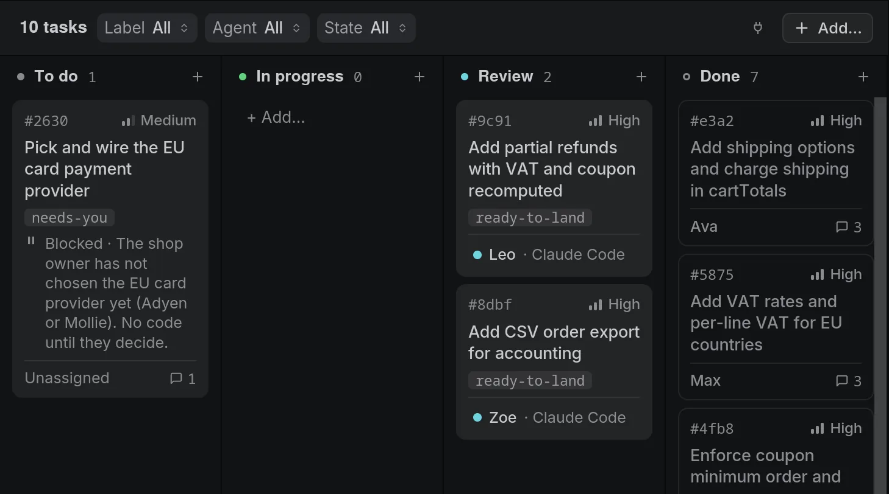
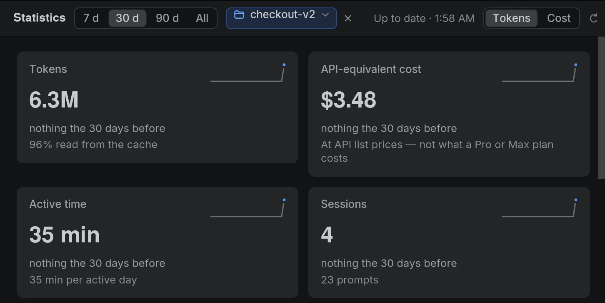

# Features

[← Hangar](../../README.md) · [Guide](README.md)

![Hangar.AI 2.0 on the checkout-v2 workspace: Iris, the orchestrator, sums up the round her workers just finished. Leo's partial refunds and Zoe's CSV export passed their check and their review, all 95 tests pass, and two deliveries wait for you to merge them; she lists what is left for you, the EU card provider and the shipping rates among it. Leo and Zoe, each in a git worktree of its own, have handed in their branches. On the right, the inspector shows Iris's session, her context use, her cost and the Claude plan's usage.](../../.github/assets/hero.webp)

Hangar 2.0's panes view on checkout-v2, a sample repository.

Hangar.AI is an open-source desktop app for Windows, macOS and Linux. It runs Claude Code,
as many sessions as you need, each in a real terminal next to plain shells, and gives them
a shared place to coordinate.

**Hangar 2.0 is native.** The whole app is written in Rust and drawn with
[iced](https://iced.rs), with no web view in it: it starts faster, and sixteen busy
terminals take a few hundred megabytes instead of several gigabytes
([Performance](#performance)). It reads the data of Hangar 1.x as it is, and a 1.x install
updates to it by itself.

Hangar launches the Claude Code installed on your machine, with your accounts and your
settings. It is not a model provider, and it has no online service of its own.

## An interface built like an IDE

- **Navigator** on the left: workspaces and folders, and each workspace's agents and their
  state at a glance.
- **Inspector** on the right: the focused pane's session, context use and cost, its board
  task, its queued prompts and the files it touched.
- **Command palette** (`Ctrl`/`Cmd`+`Shift`+`P`). Every command, pane and workspace is
  behind one search field.
- **33 themes.** Graphite is the default; the others are ported from popular VS Code
  palettes. Each theme restyles the whole window, not only the terminals.
- **Keyboard and language.** Every shortcut can be rebound, and `F6` moves between
  regions. The interface is in English or French.

## Agents and terminals

- **Claude Code and shells.** Each pane runs Claude Code or a plain shell: PowerShell,
  cmd, Git Bash, WSL, zsh, bash, fish, Nushell… Since 2.0, Claude Code is the only agent;
  a pane saved with Codex, Gemini CLI or OpenCode opens as a shell in the same folder.
- **Terminals of its own.** Hangar draws its terminals itself, on alacritty_terminal: true
  colour, mouse modes, links, search, bracketed paste, and dead keys that compose.
- **Session resume.** Claude Code panes reopen on the conversation they were in.
- **Claude Code bridge.** A small mod reports turns, permission prompts, context fill and
  plan usage, so pane states are exact rather than guessed. When an agent edits a file
  another pane just changed, it is told who changed it and asked to re-read it.
- **Broadcast.** Send one instruction to every pane at once. Claude Code panes can also
  hold it until their agent is free.
- **Pane tools.** Zoom a pane to the full grid, search its scrollback, drop a file on it
  to paste its path, or run a saved command in it.

## Workspaces

- **Saved workspaces.** A workspace is a project folder and its layout, and reopening it
  brings every agent back. Workspaces can be grouped in folders, or moved to a window of
  their own.
- **From a Git repository.** In the new-workspace dialog, choose *From a Git repository*,
  paste `owner/repo` or an https or ssh address, and see the folder it will be cloned into
  before anything runs. Hangar clones it (with progress, and a Cancel), opens a workspace
  and starts an orchestrator that reads the repository and gets it ready. A folder that
  already holds the repository is reused. Set the folder repositories go in under *Projects
  folder* in the settings; left empty, it is next to the current workspace's folder.
- **Sleep.** A workspace idle for 10 minutes is put to sleep to free memory. When you open
  it again, its agents resume their sessions. You can change the delay or turn this off.
- **MCP servers per workspace.** Choose which MCP servers a workspace's Claude Code panes
  start, instead of starting every configured server in every pane.
- **Git worktrees and diffs.** Create, lock and remove worktrees, open one in a pane or in
  its own workspace, and see what an agent changed in its folder.

## Board, memory and statistics

- **Task board.** Priorities, dependencies, labels, assignees and comments. It opens as a
  full view or as a panel beside the terminals. Stored in `.hangar/board.json` in the
  project.
- **Global memory.** Agents search, write and update facts across projects. You can browse
  and edit them in the Memory view.
- **Usage statistics.** Tokens, active time and the equivalent cost at API prices, per
  project and model. They are read from the transcripts Claude Code keeps on disk. On a
  Claude subscription, the cost figure is an equivalent, not a bill.

## Kits and previews

- **Kits** bring a domain into Hangar: a Claude Code plugin, setup commands, and tabs of
  their own. A tab is either an HTML page or, new in 2.0, a native tab written in Rust and
  compiled to WebAssembly, which Hangar draws in your theme. The **Library** in
  **Settings → Kits** lists the public kits of the [hangar-ai](https://github.com/hangar-ai)
  organization. See [Kits](#kits).
- **Previews.** Agents show you files as panes of the grid, beside their terminal: images
  (animated GIF and WebP too), code and text with highlighting, Markdown, PDFs, web pages,
  video and audio.
- **3D preview.** Agents show you a model (glTF/GLB, OBJ, STL, PLY, FBX) in a pane of the
  grid, with its glTF animations, and render snapshots to check their own work.
- **Your own control layout.** A preview and a kit's tab are panes like the terminals: drag
  them by their header onto another pane, resize them with the dividers, zoom them, reach
  them with `Ctrl`+`1`…`9`. Kit tabs come back where you left them after a restart.

What needs a browser engine, a PDF, a web page, a video or an HTML kit tab, opens in
`hangar-webview`, a small helper program beside Hangar, in a window of its own; its pane
holds a card that brings the window forward, and closing the pane closes the window.

## Experiments

Settings › Experiments turns on features that work but may still change. They are off
until you enable them, and each can be turned off again without losing anything.

- **Chat view.** Switch a workspace between its panes and a chat with its orchestrator.
  Claude Code keeps running in the panes behind it; a side panel lists the board's tasks
  with the progress their agents report (`board_report_progress`), and kits, previews and
  the 3D view open beside the chat as they do in the grid. Claude's questions and
  permission prompts become cards you answer in the chat.
- **Nodes.** Run a headless Hangar, `hangar-node`, on a Linux machine you reach over SSH
  (x86_64 or arm64: a server, a VPS, a GPU box, a Raspberry Pi). Add it in Settings › Nodes
  with its SSH target: Hangar installs it with your SSH keys, starts it and keeps a tunnel
  to it, with nothing to open on the server. A workspace can then live on the node: its
  terminals, Claude Code, board and memory run there, the window shows them like a local
  workspace's, and it catches up on what happened while your computer was off. Design:
  [docs/native/nodes.md](../native/nodes.md).
- **Pane scopes** (Linux). Each pane runs in a systemd scope of its own, so when memory runs
  out the system stops the pane that uses it, a build for instance, rather than Hangar and
  every agent with it.

## Also

- **Dictation.** Hold a key, speak, and the text is typed into the focused pane. It runs
  locally with whisper.cpp, on a model downloaded once. Groq is an optional alternative, with
  its key kept in the system keychain.
- **Discord Rich Presence**, off unless you turn it on.

## Kits

A kit links a domain, a game engine, a studio's tools, a service, to a workspace, without
Hangar knowing anything about it. It can bring a Claude Code plugin (skills, commands,
agents, MCP servers), setup commands that you see verbatim and run once, and tabs: pages of
its own that talk to Hangar through a small, declared API, each permission accepted by you.

- **HTML tabs** are the tabs of 1.x, with the same `window.hangar` API, the same
  permissions, and [Hangar UI](../kit-ui.md), the stylesheet that makes them look like
  Hangar. In 2.0 they open in the `hangar-webview` helper, in a window of their own.
- **Native tabs** (new in 2.0) are Rust compiled to WebAssembly with the kit SDK,
  `hangar-kit-sdk`. A tab describes its page as widgets, and Hangar draws them with its own,
  in your theme and language. The module runs in a sandbox with time and memory limits, and
  Hangar answers only the calls its manifest declares. A kit can carry both kinds, so that it
  still opens on 1.x.

Add a kit from a folder, a GitHub link or the Library. To write one, read
[docs/kits.md](../kits.md) (the contract) and
[docs/native/kits-native.md](../native/kits-native.md) (native tabs and the SDK), look at
[`examples/kits/hello-native`](../../examples/kits/hello-native), and start from
[`kit-template`](https://github.com/hangar-ai/kit-template).

## Performance

Hangar 1.12.1, the last release built on a web view, against Hangar 2.0, on the same Linux
machine:

| | 1.12.1 | 2.0 |
|---|---|---|
| Start, cold | 0.96 s | 0.57 s |
| Memory at rest | 238 MiB | 166 MiB |
| 16 terminals printing non-stop for 30 s: memory | 8.1 GiB | 249 MiB |
| 16 terminals printing non-stop for 30 s: processor | 4.4 cores | 2.4 cores |
| Echo of text sent to a pane while 15 others print | no echo within a minute | 2.5 ms |

Each terminal parses its output on a thread of its own, and the window draws at most once
per frame whatever they print, so a busy pane never holds up the one you type in. The method
and the raw figures are in [docs/native/BENCHMARK.md](../native/BENCHMARK.md).
