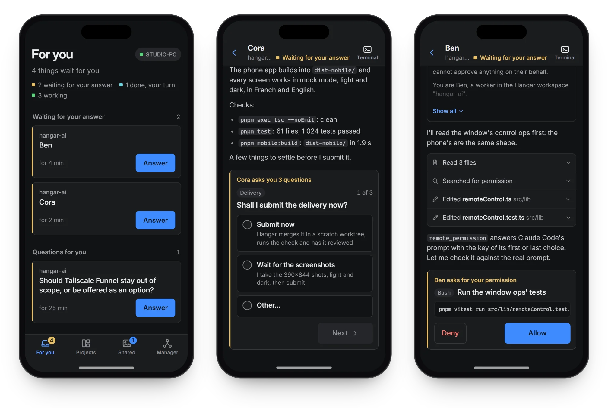

# Hangar Mobile

[← Hangar](../../README.md) · [Guide](README.md)

  

Hangar Mobile follows and steers your projects from your phone, while Hangar keeps running
on your PC. **For you** lists what waits for you in every project: an agent asking for a
permission, a question from an orchestrator, a delivery ready to land. You can read any
pane's screen as it updates, answer an agent, allow or deny a permission, press `Esc` or
`Enter`, and attach a photo or a file. You can also talk to the project manager, open the
images and files agents share with you, and see what happened since your last visit.
Notifications reach the phone even with the app closed. Merging a delivery is still done
on the PC.

A Claude Code pane, and the project manager, open as a conversation rather than a copy of
the terminal: your messages, Claude's answers, one line per action. When Claude asks you
something, each question shows with its options as large buttons, and a **Terminal** button
still shows any pane's raw screen. Shells keep the terminal view.

It is a web app that Hangar itself serves, and that you add to the phone's Home Screen.
There is no app store, no account and no server of ours in between.

**Set it up** (once, about a minute):

1. **Install [Tailscale](https://tailscale.com/download)** on the PC and on the phone, and
   sign in to the same account on both. It is a free app that links your own devices
   through a private network, wherever they are.
2. **Turn Hangar Mobile on** in Hangar, under **Settings → Mobile**.
3. **Click "Turn on HTTPS access"** in the same section. Tailscale then gives Hangar
   Mobile an address like `https://your-pc.your-tailnet.ts.net`. The first time, Tailscale
   may ask you to allow HTTPS on your network: open the page Hangar shows, then click
   again.
4. **Click "Show the code" and scan the QR code** with the phone's camera. It opens Hangar
   Mobile and pairs the phone. You can also type the 6-digit code, which works once and
   for five minutes.
5. **Add it to the Home Screen.** On an iPhone, in Safari, tap **Share**, then **Add to
   Home Screen**. On Android, in Chrome, open the menu and choose **Add to Home screen**
   (or **Install app**). Open Hangar from there and tap **Turn on notifications**.

> [!NOTE]
> On an iPhone, notifications need **iOS 16.4 or later**, and they only reach the app
> opened from the Home Screen, not a Safari tab.

**Security:**

- Hangar Mobile listens on `127.0.0.1` only, on a port of its own, apart from the agents'
  API: nothing is opened on your local network or on the Internet.
- Tailscale Serve is the only way in, over HTTPS, and only from devices on your own
  Tailscale network.
- Each phone pairs with a one-time code. **Settings → Mobile** lists the paired phones, and
  revoking one cuts it off and stops its notifications.

Your PC has to stay on, with Hangar open, for the phone to reach it. For a few days away,
**Settings → Mobile** has two options: keep the PC from going to sleep while Hangar Mobile
is on, and start Hangar when you log in, with your workspaces and Hangar Mobile.

## What it does

Follow and steer your projects from your phone while Hangar keeps running on your PC (new
in 1.1, with a real chat since 1.2):

- **For you** lists what waits for you in every project: an agent asking for a permission,
  a question from an orchestrator, a delivery ready to land.
- **A real chat.** A Claude Code pane, and the project manager, open as a conversation:
  your messages, Claude's answers with their formatting, and one line per action that opens
  its detail. Shells keep the terminal view.
- **Claude's questions as buttons**, several choices when it allows them, and "Other" with a
  text field. Your answer reaches the session on the PC as if you had typed it there.
- **Permissions** show the tool and what it will do (the command, the file), with Allow and
  Deny.
- **Files and notifications.** Agents share images and files with you through
  `phone_share`, and notifications reach the phone even with the app closed.
- **Since your last visit** shows what happened while you were away.
