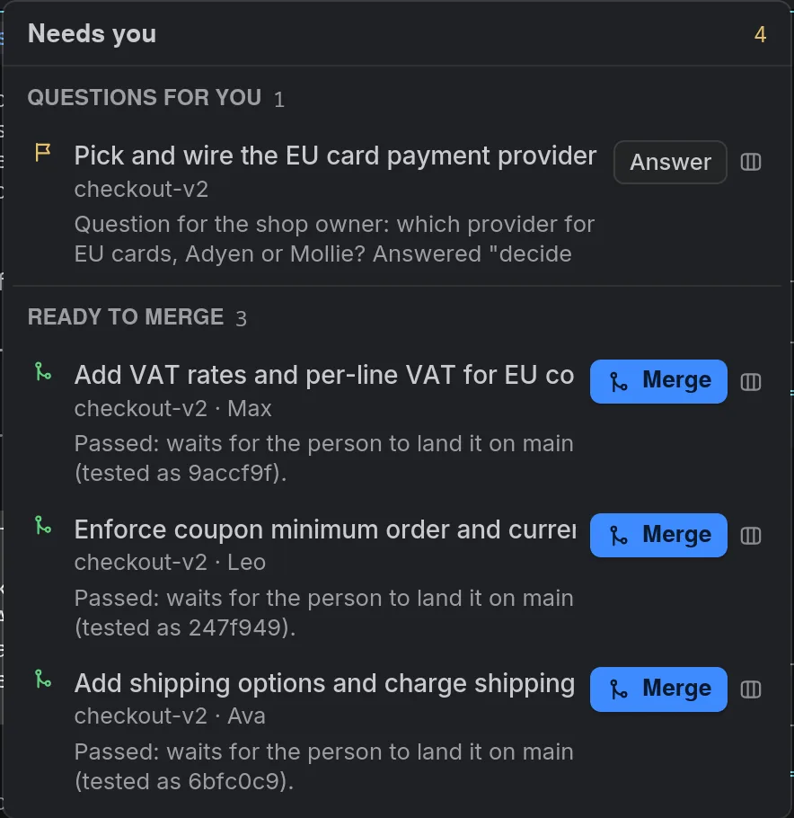
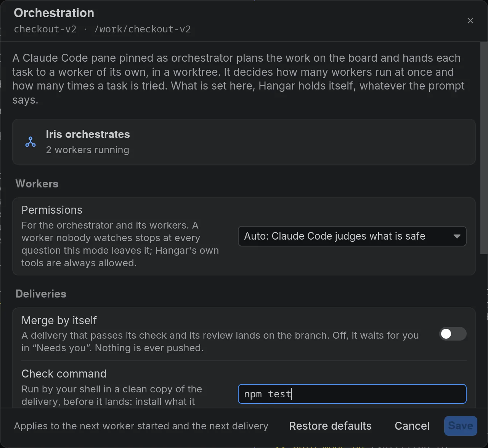

# Orchestration and the project manager

[← Hangar](../../README.md) · [Guide](README.md)

## Orchestrator mode

A new workspace starts with one Claude Code pane that is its orchestrator (**More
options** in the create dialog offers other setups); in an existing workspace, pin a
Claude Code pane as its orchestrator. It plans the work on the board and starts workers to
carry it out. You follow everything from one window.

**How it works**

1. **Plan.** The orchestrator breaks the goal into board tasks. Each task lists its
   dependencies and the files it owns.
2. **Start workers.** `worker_spawn` gives a task to a new Claude Code pane (Sonnet by
   default). The worker runs in its own git worktree, on a new branch from the target
   branch, with a block of 20 ports for its dev servers and tests.
   There is no limit on how many workers run at once, or on how many times a task is
   tried: the orchestrator decides, and hands a task back to you when it needs you.
   Hangar still refuses, whatever the prompt says, a task whose files overlap a task
   already in progress.
3. **Deliver.** A worker hands in its branch with `delivery_submit`, and the branch joins
   a merge queue. Each delivery goes through four steps:
   - the branch is merged in a temporary worktree;
   - the workspace's check command (`pnpm test`, `cargo test`…) runs there, if you set
     one;
   - a separate reviewer agent reads the change with a fresh context and read-only tools;
   - if all of that passes, the branch lands on the target branch by fast-forward.

   If a step fails, the worker receives what failed and fixes it. Hangar never pushes, and
   a landing that would overwrite your uncommitted changes is held back.
4. **Wake on events.** The orchestrator does not poll. When it is between turns, Hangar
   sends it one batched message: a worker commented, is waiting, or exited; a delivery
   landed or failed.
5. **Needs you.** One list, across workspaces, shows what waits for you:
   - agents asking for a permission or an answer;
   - questions the orchestrator handed back to you;
   - deliveries ready to merge, when automatic merging is off.

You set the following per workspace: the models of the orchestrator, workers and reviewer
(Opus, Sonnet and Sonnet by default), the check command, the target branch,
automatic merging (on by default) and the permission mode. Orchestration needs a git repository and
Claude Code.

<table>
  <tr>
    <td width="50%"></td>
    <td width="50%"></td>
  </tr>
  <tr>
    <td align="center">Needs you: what waits for you, across workspaces</td>
    <td align="center">Orchestration settings of a workspace</td>
  </tr>
</table>

## Project manager

One agent to talk to instead of every project's agents (new in 1.0.3). Open it from the top
of the sidebar or the command palette: Hangar creates an HQ workspace with its own folder and
one Claude Code agent (Opus by default) that follows every workspace, with or without an
orchestrator.

- **Ask it where your projects stand:** agents, boards, what waits for you, deliveries ready
  to land, each plan's status.
- **Ask it to pass an instruction on.** It is queued for that project's orchestrator, and a
  sleeping workspace wakes up.
- **It speaks up only for what waits for you:** an agent waiting for an answer or a
  permission, a task marked needs-you, a delivery ready to land, a board whose tasks are all
  done.

It keeps a tracker of what you want from each project, handed back after every compaction.
It never writes code and never acts on its own. On your phone, Hangar Mobile opens it as a
chat.
